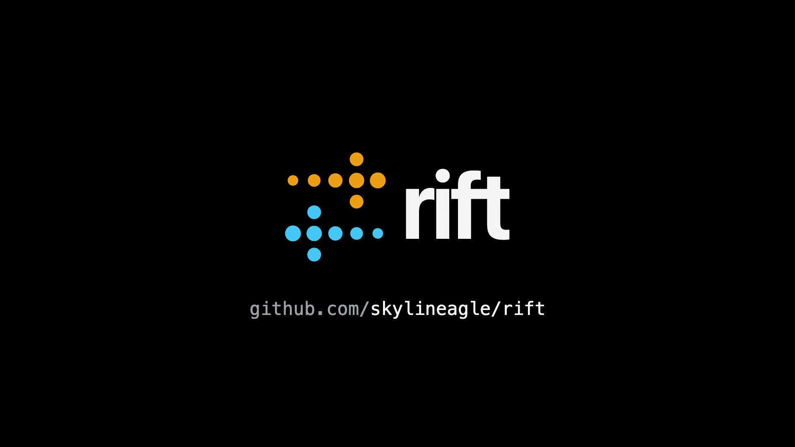

<p align="center">
  
</p>

<h1 align="center">rift</h1>

<p align="center">Bridge TCP, UDP and serial (UART) endpoints. Pipe bytes between any two sides, inspect traffic, inject data live.</p>

Created in [T3 Code](https://t3.codes).

<p align="center">
  <a href="showcase/video/out/promo/v1/promo.mp4"></a>
  <br>
  <a href="showcase/video/out/promo/v1/promo.mp4">Watch the 30s demo</a> · <a href="showcase/deck">Slide deck</a> (open-slide: <code>cd showcase/deck && bun install && bun run dev</code>)
</p>

**[Documentation](https://skylineagle.github.io/rift/)**: user manual and developer manual (source in [`apps/docs`](apps/docs)).

## Install

Download from the [latest release](https://github.com/skylineagle/rift/releases/latest):

| Platform | Desktop app (includes the CLI) | CLI only |
| --- | --- | --- |
| Linux | `.deb`, `.rpm`, `.AppImage` | `rift-<version>-<arch>-unknown-linux-gnu.tar.gz` |
| macOS | `.dmg` (Apple Silicon or Intel) | `rift-<version>-<arch>-apple-darwin.tar.gz` |
| Windows | `.exe` installer | `rift-<version>-x86_64-pc-windows-msvc.zip` |

Installing the desktop app also puts `rift` on your PATH: the Windows installer adds its folder to the user PATH,
`.deb`/`.rpm` install it to `/usr/bin`, and on macOS the app links it into `/usr/local/bin` (or `~/.local/bin`) on first launch.
The `.AppImage` does not install the CLI.

CLI only, on Linux (no Rust needed, runs on glibc 2.17+, e.g. Ubuntu 14.04 and later; needs `libudev1`):

```sh
curl -fsSL https://github.com/skylineagle/rift/releases/latest/download/rift-<version>-x86_64-unknown-linux-gnu.tar.gz | tar xz
sudo mv rift /usr/local/bin/
```

Use `aarch64` instead of `x86_64` on ARM.

Container image: `docker pull ghcr.io/skylineagle/rift` (see [Container](#container)).

From source (needs [Rust](https://rustup.rs) and, on Linux, `libudev-dev`):

```sh
cargo install --git https://github.com/skylineagle/rift rift-cli
# or, from a checkout
cargo install --path crates/rift-cli
```

## Usage

```sh
rift pipe tcp-server://0.0.0.0:9000 uart:///dev/ttyUSB0?baud=115200
rift run -c examples/rift.toml gps        # or --all
rift profile add gps tcp-server://0.0.0.0:9000 uart:///dev/ttyUSB0?baud=9600
rift profile list | rift profile remove gps
rift ports
```

### Examples

```sh
# Expose a serial device over the network (any TCP client sees the UART)
rift pipe tcp-server://0.0.0.0:9000 "uart:///dev/ttyUSB0?baud=115200"

# Forward UDP datagrams to a remote TCP service
rift pipe udp-server://0.0.0.0:5000 tcp://example.com:7000

# Relay between two UDP peers with a fixed local port
rift pipe "udp://10.0.0.5:6000?bind=0.0.0.0:7000" udp-server://0.0.0.0:5000

# Serial with 8E1 framing and hardware flow control
rift pipe tcp-server://0.0.0.0:9000 "uart:///dev/ttyUSB0?baud=9600&parity=even&flow=hardware"

# Accept one TCP client only, reconnect faster to the other side
rift pipe "tcp-server://0.0.0.0:9000?max_clients=1" "tcp://192.168.1.20:4000?reconnect_delay_ms=200"

# Log as JSON lines for piping into jq or a log collector
rift run --all --log json | jq .

# Start a side disabled, enable it later from stdin with `b on`
rift pipe tcp-server://0.0.0.0:9000 "tcp://example.com:7000?enabled=false"
```

Ready-made configs live in [`examples/`](examples), one file per connection pair (named `<side-a>-to-<side-b>.toml`),
plus multi-profile setups in [`examples/combos/`](examples/combos):

| File | Shows |
| --- | --- |
| `tcp-server-to-uart` | Serial device shared over TCP, exclusive client, 7E2 + hardware flow |
| `tcp-client-to-uart` | UART streamed to a remote collector with fast reconnect |
| `tcp-server-to-tcp-client` | Plain TCP port forward |
| `tcp-server-to-tcp-server` | Rendezvous: two inbound parties joined |
| `tcp-client-to-tcp-client` | Join two devices that only accept connections |
| `udp-server-to-uart` | UDP to serial, replies to last sender |
| `udp-client-to-uart` | Serial telemetry pushed to a fixed UDP target |
| `udp-server-to-tcp-client` | Many UDP senders funneled into one TCP stream |
| `tcp-server-to-udp-client` | TCP-only tools reaching a UDP service |
| `udp-client-to-udp-server` | UDP relay with peer timeout |
| `uart-to-uart` | Baud-rate adapter between two serial ports |
| `combos/sensor-gateway` | GPS, modem and IMU each on their own port |
| `combos/cloud-uplink` | Primary uplink plus a disabled backup you switch on live |
| `combos/protocol-translator` | One service reachable over TCP, UDP and serial |
| `combos/lab-bench` | UART sniffing loop plus a local remote console |

```sh
rift run -c examples/combos/sensor-gateway.toml --all
rift run -c examples/tcp-server-to-uart.toml serial-over-tcp
```

Try it locally with two terminals:

```sh
rift pipe tcp-server://0.0.0.0:9000 udp-server://0.0.0.0:5000 --log text
nc localhost 9000              # type here, it shows up for UDP peers on :5000
```

Endpoint URIs: `tcp://host:port`, `tcp-server://0.0.0.0:9000`, `udp://host:port[?bind=0.0.0.0:7000]`,
`udp-server://0.0.0.0:5000`, `uart:///dev/ttyUSB0?baud=115200&parity=even&data_bits=8&stop_bits=1&flow=none`.

Endpoint options (URI query params, same names as the TOML keys; omitted means default):

| Endpoint | Option | Default | Meaning |
| --- | --- | --- | --- |
| `tcp` | `reconnect_delay_ms` | `1000` | Initial reconnect delay; backoff doubles from it up to 10s |
| `tcp` | `connect_timeout_ms` | `5000` | Give up a connection attempt after this long |
| `tcp` | `no_delay` | `true` | Set `TCP_NODELAY` |
| `tcp-server` | `max_clients` | unlimited | Extra connections are accepted, then closed with an error event |
| `tcp-server` | `no_delay` | `true` | Set `TCP_NODELAY` on accepted connections |
| `udp` | `bind` | auto | Local address to bind |
| `udp-server` | `reply_to` | `all` | `all` or `last`: which peers receive data written to this side |
| `udp-server` | `peer_timeout_secs` | none | Forget peers silent for this long and emit a disconnected status |
| any | `enabled` | `true` | `false` leaves the side closed; data heading to it is dropped and it reports `disabled` |

Flags for `run`/`pipe`: `--log text|hex|json` (default hex), `--quiet`.
Config path: `--config` > `RIFT_CONFIG` > OS config dir `rift/rift.toml`.

While running, stdin lines inject data: `[profile:]<a|b|both> <text|hex|bin|file> <payload>`,
e.g. `a hex de ad be ef`, `gps:both text hello\r\n`, `b file ./frame.bin`.
Switch a side at runtime with `[profile:]<a|b> <on|off>`, e.g. `b off`, `gps:a on`.

### Injecting from another terminal

`rift inject` and `rift workflow` talk to a Rift that is already running on the same machine (`rift run`, `rift pipe` or the desktop app).

```sh
rift inject gps a text 'PING\r\n'                      # <profile> <a|b|both> <text|hex|bin|file> <payload...>
rift inject gps both hex de ad be ef
rift inject gps b file ./frame.bin
rift inject gps a text PING --every 500ms              # repeat until stopped
rift inject gps a text PING --every 1.5s --count 10    # repeat 10 times
rift workflow stop gps cli-inject                      # stop a repeating inject
```

Payload words are joined by one space. Put `--` before a payload that starts with `-`.
`--every` takes `ms`, `s` or `m` and runs as a workflow named `cli-inject`, one at a time per profile.
A control request is capped at 64 KiB, so send large payloads with the `file` format, which passes only the path.

### Workflows

A workflow is a named list of `send` and `wait` steps saved with a profile:

```toml
[[profile]]
name = "gps"
a = { kind = "tcp-server", bind = "0.0.0.0:9000" }
b = { kind = "uart", port = "/dev/ttyUSB0", baud_rate = 9600 }

[[profile.workflows]]
name = "heartbeat"
autostart = true   # default false: start together with the profile
repeat = 10        # omit to loop forever
steps = [
  { action = "send", target = "Both", format = "text", payload = "PING\\r\\n" },
  { action = "wait", millis = 1000 },
]
```

```sh
rift workflow list [-c file]          # workflows saved in the config
rift workflow start gps heartbeat
rift workflow stop gps heartbeat
rift workflow status                  # running instances, their profiles and workflows
```

### Logging

Structured logs (profile and connection changes, drops, workflows, periodic traffic stats) are configured by the `[logging]`
section of the config file, with `console` (stderr), `file` (rotating) and `http` (NDJSON or JSON array) sinks.
All sinks are off by default. See [`examples/rift.toml`](examples/rift.toml) for every key.

```toml
[logging.file]
enabled = true
directory = "/var/log/rift"
```

`run`, `pipe` and `profile add|remove` use it. `pipe` reads it from the resolved config path (or `-c`) when that file exists.

## Agent skills

Skills that teach AI agents to run pipes and manage profiles live in [`skills/`](skills):

```sh
npx skills add skylineagle/rift
```

## Desktop app

A Tauri desktop app (`apps/desktop`) wraps the same engine with a UI for profiles, live traffic and data injection.
It reads the same config file as the CLI, so profiles you add with `rift profile add` show up in the app.

Requirements: [Rust](https://rustup.rs), [Bun](https://bun.sh) and the [Tauri prerequisites](https://tauri.app/start/prerequisites/) for your OS
(on Linux also `libudev-dev`).

```sh
cd apps/desktop
bun install

bun run tauri dev      # run with hot reload
bun run tauri build    # local installable bundle (.dmg/.app, .msi/.exe, .deb/.AppImage)
```

Bundles land in `target/release/bundle/`. On macOS, install by opening the `.dmg` and dragging Rift to Applications.

## Container

Image runs `rift run --all --log json --quiet` against `/config/rift.toml` by default, so only status events are logged. Override the command without `--quiet` to log traffic too.
Released images are published for `linux/amd64` and `linux/arm64` as `ghcr.io/skylineagle/rift:<version>` and `:latest`;
use that name in place of `rift` below to skip the local build.

```sh
docker compose up --build      # uses docker-compose.yml, mounts ./examples as /config
```

Mounts `./examples` as `/config`; uncomment `devices:` in `docker-compose.yml` to pass a UART through.

Plain `docker`:

```sh
docker build -t rift .

# All profiles from your own config
docker run --rm -v "$PWD/examples:/config:ro" -p 9000:9000 -p 5000:5000/udp rift

# One profile
docker run --rm -v "$PWD/examples:/config:ro" -p 9000:9000 rift run gps

# Ad-hoc pipe, no config needed
docker run --rm -p 9000:9000 -p 5000:5000/udp rift \
  pipe tcp-server://0.0.0.0:9000 udp-server://0.0.0.0:5000

# Serial passthrough (Linux host)
docker run --rm --device /dev/ttyUSB0 -p 9000:9000 rift \
  pipe tcp-server://0.0.0.0:9000 "uart:///dev/ttyUSB0?baud=115200"

# List serial ports visible to the container
docker run --rm --device /dev/ttyUSB0 rift ports
```

Bind servers to `0.0.0.0` inside the container so published ports reach them. Serial passthrough needs a Linux host; Docker Desktop on macOS/Windows can't pass USB devices.

## Crates

- `rift-core` (package `rift-bridge-core`): bridge engine, endpoints, profiles, payloads (async, serde-serializable; reused by the desktop app).
- `rift-cli`: the `rift` command.

## Releasing

Bump `version` in the root `Cargo.toml`, commit, then push a matching tag:

```sh
git tag v0.2.0 && git push origin v0.2.0
```

`.github/workflows/release.yml` builds the CLI archives, desktop installers and Docker image, attaches them to a draft
GitHub release and publishes it once everything succeeds. CI (`.github/workflows/ci.yml`) runs on every push to `main` and on pull requests.
macOS signing and notarization are used when the `APPLE_CERTIFICATE`, `APPLE_CERTIFICATE_PASSWORD`, `APPLE_SIGNING_IDENTITY`,
`APPLE_ID`, `APPLE_PASSWORD` and `APPLE_TEAM_ID` secrets are set.
